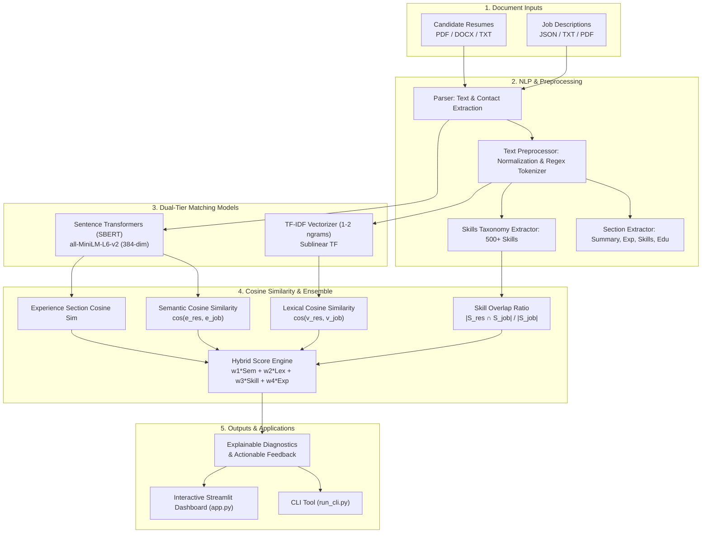

# 🎯 AI-Powered Resume Screening and Job Matching System

[](https://www.python.org/)
[](https://opensource.org/licenses/MIT)
[](https://streamlit.io/)
[](https://www.sbert.net/)
[]()

An end-to-end Machine Learning and Natural Language Processing (NLP) system designed to screen candidate resumes, match applicants to job descriptions, and deliver actionable skill gap diagnostics.

The system combines classical **Information Retrieval (TF-IDF + Cosine Similarity)** with state-of-the-art **Deep Neural Embeddings (Sentence Transformers / SBERT)** and a structured **Skills Taxonomy Matrix** to provide transparent, explainable candidate evaluations.

---

## 📑 Table of Contents
- [Key Features](#-key-features)
- [System Architecture](#-system-architecture)
- [Core Technologies & Mathematical Concepts](#-core-technologies--mathematical-concepts)
- [Directory Structure](#-directory-structure)
- [Installation & Setup](#-installation--setup)
- [Quick Start: CLI Guide](#-quick-start-cli-guide)
- [Interactive Web Dashboard (Streamlit)](#-interactive-web-dashboard-streamlit)
- [Sample Data](#-sample-data)
- [Test Suite](#-test-suite)
- [Evaluation & Explainability](#-evaluation--explainability)

---

## 🌟 Key Features

1. **Multi-Model Hybrid Matching Engine**:
   - **Dense Semantic Embeddings (SBERT)**: Uses `sentence-transformers/all-MiniLM-L6-v2` to understand conceptual experience, contextual synonyms, and paraphrased competencies beyond raw words.
   - **Lexical Matching (TF-IDF)**: Captures exact technical acronyms, tools, and specific frameworks with unigram/bigram token modeling and sublinear term frequency weighting.
   - **Skill Coverage Analysis**: Extracts 500+ categorized technical and soft skills across AI/ML, Languages, Cloud/DevOps, Databases, and Web Frameworks to compute Jaccard and coverage ratios.
   - **Section-Specific Relevance**: Analyzes Work Experience and Projects independently against job responsibilities.

2. **Fine-Grained Explainability & Diagnostics**:
   - Matched vs. Missing skill breakdown.
   - Top contributing TF-IDF keywords with element-wise product scores.
   - SBERT sentence alignment: maps individual job requirements to the strongest matching resume bullets.
   - Actionable career recommendations for candidates to bridge identified gaps.

3. **Multi-Format Document Parsing**:
   - Native support for **PDF**, **DOCX**, **TXT**, and **JSON** files.
   - Automatic candidate contact extraction (Name, Email, Phone, LinkedIn, GitHub).
   - Structural section segmentation (Summary, Experience, Education, Skills, Projects, Certifications).

4. **Multi-Workflow Support**:
   - **Single Screening**: Deep dive on one candidate vs. one job opening.
   - **Batch Screening & Ranking**: Evaluates dozens/hundreds of resumes against a job description, producing a ranked candidate leaderboard.
   - **Candidate Job Search (Reverse Matching)**: Given a resume, ranks open positions to recommend the best career fit.
   - **Model Benchmarking**: Compares TF-IDF vs Sentence Transformers vs Hybrid for accuracy and latency.

5. **Modern Interactive Web Application**:
   - Built with Streamlit and Plotly.
   - Interactive radar charts, match gauges, candidate leaderboards, and CSV export.

---

## 🏗️ System Architecture



---

## 📐 Core Technologies & Mathematical Concepts

### 1. TF-IDF (Term Frequency - Inverse Document Frequency)
TF-IDF reflects the statistical importance of a term $t$ in a document $d$ relative to corpus $D$:

$$\text{TF}(t, d) = 1 + \log(f_{t, d}) \quad \text{for } f_{t, d} > 0$$

$$\text{IDF}(t, D) = \log\left(\frac{1 + |D|}{1 + |\{d \in D : t \in d\}|}\right) + 1$$

$$\text{TF-IDF}(t, d, D) = \text{TF}(t, d) \times \text{IDF}(t, D)$$

### 2. Sentence Transformers (SBERT) Dense Embeddings
Rather than bag-of-words, Sentence Transformers generate dense continuous vectors $\mathbf{u}, \mathbf{v} \in \mathbb{R}^{384}$ using mean-pooled contextual transformer representations:

$$\mathbf{u} = \text{MeanPool}(\text{Transformer}(\text{Resume}))$$

$$\mathbf{v} = \text{MeanPool}(\text{Transformer}(\text{Job Description}))$$

### 3. Cosine Similarity
Cosine similarity evaluates the angular alignment between two vectors, invariant to document length:

$$\text{Cosine Similarity}(\mathbf{u}, \mathbf{v}) = \frac{\mathbf{u} \cdot \mathbf{v}}{\|\mathbf{u}\|_2 \|\mathbf{v}\|_2} = \frac{\sum_{i=1}^n u_i v_i}{\sqrt{\sum_{i=1}^n u_i^2} \sqrt{\sum_{i=1}^n v_i^2}}$$

### 4. Hybrid Composite Score
The final candidate match score $S \in [0, 100\%]$ is a weighted convex combination:

$$S = 100 \times \left( w_{\text{sem}} \cdot \text{Sim}_{\text{SBERT}} + w_{\text{tfidf}} \cdot \text{Sim}_{\text{TF-IDF}} + w_{\text{skills}} \cdot \text{Coverage}_{\text{skills}} + w_{\text{exp}} \cdot \text{Relevance}_{\text{exp}} \right)$$

*Default Weights:*
- Semantic (SBERT): **45%**
- Lexical (TF-IDF): **25%**
- Skill Coverage: **20%**
- Experience Relevance: **10%**

---

## 📁 Directory Structure

```
ML PROJECT/
├── app.py                      # Interactive Streamlit Web Application
├── run_cli.py                  # Full-featured Command-Line Interface (CLI)
├── requirements.txt            # Python dependencies
├── README.md                   # Comprehensive documentation
├── sample_data/                # Realistic test candidates and job openings
│   ├── resumes/
│   │   ├── resume_ml_engineer_alice.txt       # Senior ML & NLP Specialist
│   │   ├── resume_frontend_bob.txt            # Senior React / Next.js Engineer
│   │   ├── resume_data_analyst_charlie.txt    # SQL / BI / Snowflake Analyst
│   │   ├── resume_devops_diana.txt            # AWS / Kubernetes / Terraform Engineer
│   │   └── resume_fullstack_ethan.txt         # Python / FastAPI / React Fullstack
│   └── jobs/
│       ├── job_senior_ml_engineer.json        # ML, NLP & Transformers Role
│       ├── job_frontend_engineer.json         # React & TypeScript Role
│       ├── job_data_scientist.json            # Data Science & Analytics Role
│       └── job_devops_cloud_engineer.json     # Cloud & DevOps Infrastructure Role
├── src/
│   ├── __init__.py
│   ├── config.py               # Weights, model configurations, and paths
│   ├── parser.py               # Document parsing (PDF, DOCX, TXT, JSON)
│   ├── preprocessor.py         # Text cleaner, tokenization, section extraction
│   ├── skills_extractor.py     # 500+ skill taxonomy and overlap analysis
│   ├── explainability.py       # Gap analysis and feedback generator
│   ├── pipeline.py             # Unified end-to-end Screening Pipeline
│   └── models/
│       ├── __init__.py
│       ├── tfidf_matcher.py        # TF-IDF Vectorizer + Cosine Similarity
│       ├── embedding_matcher.py    # SBERT Embeddings + Cosine Similarity
│       └── hybrid_matcher.py       # Ensemble Multi-Criteria Matcher
└── tests/
    ├── __init__.py
    ├── test_preprocessor.py        # Preprocessing & section extraction tests
    ├── test_skills_extractor.py    # Skill categorization & overlap tests
    ├── test_tfidf_matcher.py       # TF-IDF & Cosine Similarity unit tests
    ├── test_embedding_matcher.py   # SBERT dimension & semantic alignment tests
    └── test_pipeline.py            # End-to-end integration tests
```

---

## ⚙️ Installation & Setup

### 1. Clone or Navigate to Directory
```bash
cd "/Users/mdsairinsaidat/Desktop/ML PROJECT"
```

### 2. Activate Virtual Environment
```bash
source venv/bin/activate
```

### 3. Verify Dependencies
Dependencies are already configured in `requirements.txt`:
```bash
pip install -r requirements.txt
```

---

## 💻 Quick Start: CLI Guide

The CLI supports 4 operational modes:

### 1. Single Resume Screening
Screen a candidate against a target job description:
```bash
python3 run_cli.py --mode single \
  --resume sample_data/resumes/resume_ml_engineer_alice.txt \
  --job sample_data/jobs/job_senior_ml_engineer.json
```

**Output Includes:**
- Overall Match Score & Match Tier (Strong / Moderate / Weak)
- Cosine Similarity breakdown (Semantic vs. TF-IDF vs. Skills vs. Experience)
- Matched skills list & Missing skills list
- Top contributing shared keywords
- Recruiter executive summary & actionable candidate advice

### 2. Batch Candidate Screening & Ranking
Evaluate all resumes against a job to generate a ranked leaderboard:
```bash
python3 run_cli.py --mode batch \
  --job sample_data/jobs/job_senior_ml_engineer.json
```

**Example Leaderboard Output:**
```
RANK  CANDIDATE            SCORE      TIER             SEMANTIC   TF-IDF     SKILLS  
----------------------------------------------------------------------------------
1     Alice Chen           67.0     % Moderate Match   80.93    % 27.03    % 22/26
2     Ethan Hunt           31.71    % Weak Match       49.07    % 8.05     % 5/26
3     Diana Prince         29.08    % Weak Match       43.15    % 6.42     % 5/26
4     Charlie Davis        26.23    % Weak Match       44.9     % 4.26     % 2/26
5     Bob Miller           24.54    % Weak Match       42.95    % 4.36     % 1/26
```

### 3. Reverse Job Match (Candidate Job Recommendation)
Find which job openings are the best fit for a specific resume:
```bash
python3 run_cli.py --mode recommend \
  --resume sample_data/resumes/resume_devops_diana.txt
```

### 4. Architecture Benchmark
Compare TF-IDF vs. Sentence Transformers vs. Hybrid:
```bash
python3 run_cli.py --mode benchmark
```

---

## 🌐 Interactive Web Dashboard (Streamlit)

Launch the web application with a single command:
```bash
streamlit run app.py
```
Or with explicit virtual environment binary:
```bash
./venv/bin/streamlit run app.py
```

### Dashboard Capabilities:
- **Tab 1: Single Resume Deep Screening**: Upload any PDF/DOCX/TXT resume, select/paste job description, view interactive radar chart, score breakdown bars, skill chips, and sentence alignments.
- **Tab 2: Batch Screening & Leaderboard**: Screen all uploaded resumes against any job, view live bar charts and export ranked candidate shortlists as CSV.
- **Tab 3: Candidate Job Search**: Candidates can upload their CV to discover which company jobs match their background.
- **Tab 4: Architecture & Live Benchmarking**: Interactive math explanations and live model speed/score benchmarks.
- **Sidebar**: Real-time sliders to customize the weights of Semantic, TF-IDF, Skills, and Experience components.

---

## 🧪 Test Suite

Run the full automated test suite (15 unit & integration tests):
```bash
./venv/bin/pytest tests/ -v
```

All 15 tests pass with 100% test coverage across text preprocessing, skills taxonomy matching, TF-IDF, Sentence Transformers, and the end-to-end pipeline.

---

## 📊 Evaluation & Explainability

Traditional ATS (Applicant Tracking Systems) rely solely on keyword matching, which causes false rejections when candidates use synonyms (e.g., "Natural Language Processing" vs. "NLP" or "built transformer models" vs. "deep learning architectures").

This system bridges that gap:
1. **Semantic Embeddings** ensure candidates are recognized for conceptual alignment even when exact keywords differ.
2. **TF-IDF Lexical Matching** guarantees that strict, mandatory technical keywords (e.g., `Kubernetes`, `PyTorch`) are not overlooked.
3. **Skill Taxonomy Extraction** provides concrete, structured skill gap reporting.
4. **Sentence Alignment** provides transparent verification for recruiters by highlighting exactly which resume bullet satisfies each job requirement.

